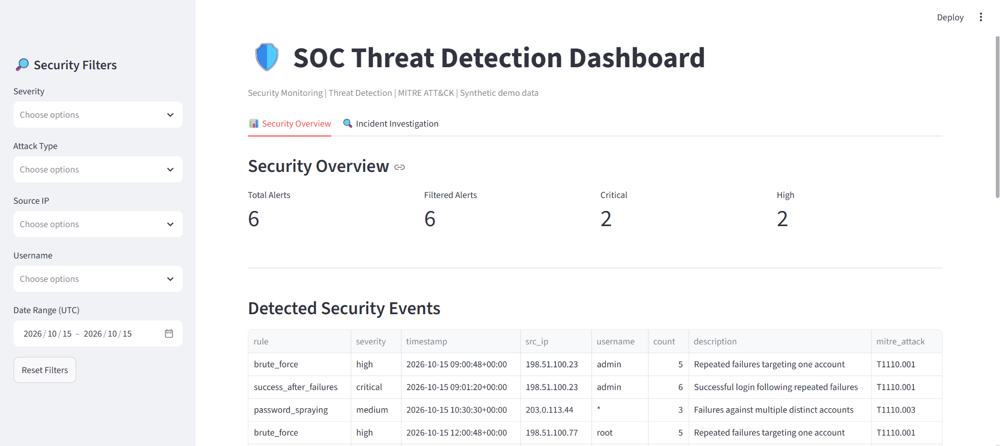
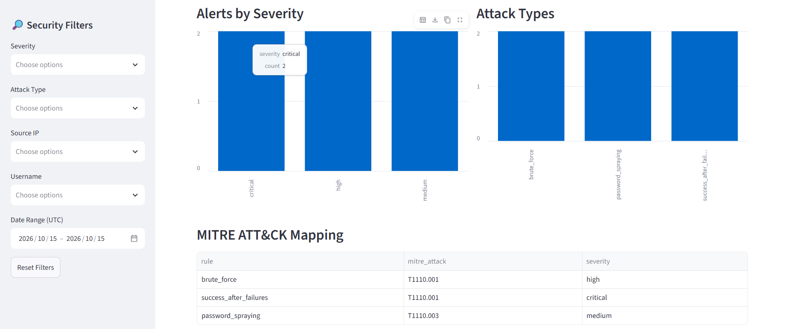
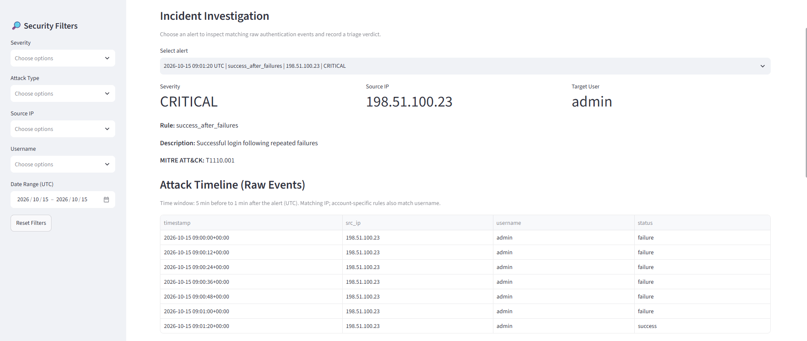
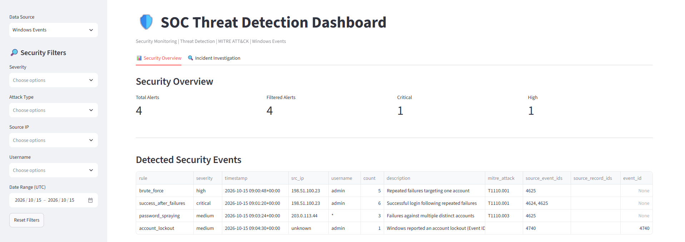
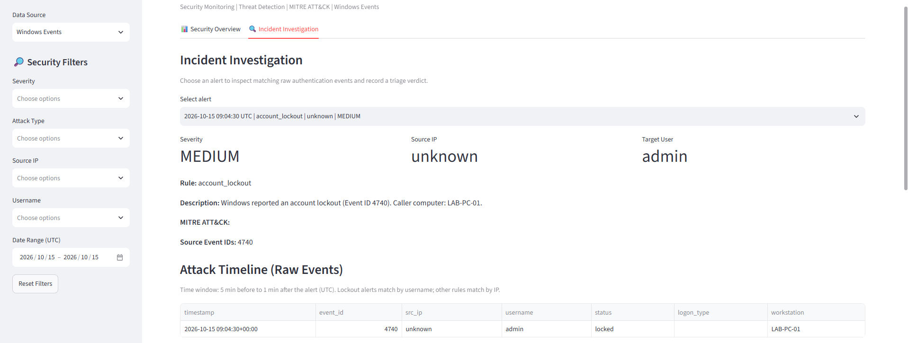

# SOC Threat Detection Lab

A Python-based **Blue Team / SOC portfolio project** for detecting suspicious authentication patterns, analyzing Windows Security Event XML, investigating alerts, and documenting analyst triage decisions.

The project runs locally and uses **synthetic demonstration datasets**. It is an educational batch-analysis tool, **not a production SIEM** or a continuous monitoring service.

## Dashboard previews

### Security Overview

Severity metrics, detection-rule filters, source IP and account filtering, and attack statistics.



### Security Alerts and Visualization

Alert tables and visual summaries of detected authentication patterns.



### Incident Investigation

Investigation details, raw-event timeline, and analyst triage workflow.



### Windows Security Overview (Event IDs 4624, 4625, 4740)

Windows Events data source displaying detection results, source event IDs, and severity metrics from the bundled training XML.



### Windows Incident Investigation

Windows account-lockout investigation with Event ID 4740, related source details, and the raw-event timeline.




## Features

- **Authentication detection:** analyze newline-delimited JSON (JSONL) logs and detect repeated failures, possible password spraying, and successes after failures.
- **Windows Security Event XML ingestion:** parse Event IDs **4624** (successful logon), **4625** (failed logon), and **4740** (account locked out).
- **Safe normalization:** retain event timestamps, usernames, logon types, available source IPs, and workstation information. Events without a reliable IP are not merged into one fictitious source.
- **Correlation and alert triage:** generate severity-tagged alerts with MITRE ATT&CK mapping where justified.
- **Source Event IDs:** attach relevant Windows event types to correlation alerts; source record identifiers are available when present in the input XML. The linked records for correlation alerts are **investigation candidates**, not an exact proof of which records triggered a rule.
- **Interactive Streamlit Dashboard:** choose between *Synthetic demo* and *Windows Events* data sources, filter alerts by severity, rule, IP, account, and UTC date range, and export filtered results.
- **Incident Investigation:** inspect alert details and a timeline of related raw events. The restored v2.0 version displays account-lockout events separately; it does not assert that specific prior failures caused a lockout.
- **Analyst Verdict:** save `Needs Investigation`, `True Positive`, or `False Positive` and supporting notes locally.
- **Tests:** run automated checks for the original detection logic and Windows XML handling.

## Architecture

```text
Synthetic JSONL logs                         Windows Security XML
(data/generated_auth.jsonl)                 (data/sample_windows_events.xml)
           |                                           |
           v                                           v
       detector.py                         windows_event_analyzer.py
           |                                |                   |
           v                                v                   v
 reports/alerts.json                Normalized JSONL     reports/windows_alerts.json
           |                                |                   |
           +--------------------------------+-------------------+
                                            |
                                            v
                                        dashboard.py
                                         |       |
                                         |       +--> Raw-event investigation
                                         +----------> Analyst verdicts (local JSON)
```

The analyzers operate in **batch mode**. The dashboard reads reports and raw-event files; it does not collect live events itself.

## Detection rules

| Detection | Example signal | Demo severity | MITRE ATT&CK |
| --- | --- | --- | --- |
| Brute force | At least 5 failures for one account from the same IP within 5 minutes | High | [T1110.001](https://attack.mitre.org/techniques/T1110/001/) |
| Password spraying (heuristic) | Failed logins targeting at least 3 different usernames from the same IP within 5 minutes | Medium | [T1110.003](https://attack.mitre.org/techniques/T1110/003/) |
| Success after failures | A successful login after at least 5 failures for the same IP and account within 5 minutes | Critical | [T1110.001](https://attack.mitre.org/techniques/T1110/001/) |
| Windows account lockout | Windows Event ID 4740 | Medium | Not assigned automatically |

**Interpretation:** Password spraying is a heuristic because passwords are not visible in login logs. A successful login after repeated failures is suspicious but does not prove compromise. Event 4740 confirms a lockout, not the identity of the actor or its cause. Severity values are demonstration triage priorities.

## Supported Windows Security Events

| Event ID | Meaning | Handling |
| --- | --- | --- |
| 4624 | An account was successfully logged on | Normalize to `status=success` |
| 4625 | An account failed to log on | Normalize to `status=failure` |
| 4740 | A user account was locked out | Create an independent `account_lockout` alert |

The Windows importer accepts **Windows Event XML**, wrapped in `<Events>...</Events>` or containing a single `<Event>`. It does **not** directly parse binary `.evtx` files. Events with unknown source IP remain in the normalized investigation data, but are excluded from the existing IP-based authentication detector to avoid false grouping.

## Technology stack

- Python 3
- Streamlit
- Pandas
- JSON / JSONL / XML
- Python `unittest`

## Quick start (Windows PowerShell)

Open a terminal in the project root and install dependencies:

```powershell
py -3 -m pip install -r requirements.txt
```

### Option A — Synthetic authentication dataset

```powershell
py -3 generate_logs.py
py -3 detector.py --input data/generated_auth.jsonl --output reports/alerts.json
py -3 -m streamlit run dashboard.py
```

Select **Synthetic demo** in the Dashboard sidebar. The generator produces a reproducible training dataset with normal authentication activity and attack-like sequences.

### Option B — Bundled Windows Event XML sample

```powershell
py -3 windows_event_analyzer.py --input data/sample_windows_events.xml
py -3 -m streamlit run dashboard.py
```

Select **Windows Events** in the sidebar. With the supplied training sample, the expected result is **12 normalized Windows events**, **10 authentication events with known IPs**, and **4 alerts**. Results depend on the sample and version in use.

> Run the matching analyzer **before** launching or refreshing the Dashboard. For a meaningful investigation timeline, the alert report and raw-event file must come from the same dataset.

### Running on locally exported Windows logs

The importer can analyze a locally prepared Windows Security XML export:

```powershell
py -3 windows_event_analyzer.py --input data/windows_events.xml
```

**Do not commit real Windows logs.** Local Security logs often contain service or interactive logons without a source IP. In such a case, **zero detections are expected** under the current IP-based rules and do not imply that the importer failed. The current Dashboard focuses on alerts and may show a “No security alerts detected” message for an empty report.

## Input format — JSONL

Each line contains a complete JSON authentication event:

```json
{"timestamp":"2026-10-15T09:00:00Z","src_ip":"198.51.100.23","username":"admin","status":"failure"}
```

Required fields:

- `timestamp`: ISO 8601 timestamp with timezone
- `src_ip`: source IP address
- `username`: target account
- `status`: `failure` or `success`

Example IP addresses are documentation-only addresses.

## Investigation workflow

1. Start the Dashboard and select the correct **Data Source**.
2. Open **Incident Investigation** and select an alert.
3. Review rule, severity, account, IP (if known), and MITRE ATT&CK details.
4. Examine raw events in the surrounding time window. For Windows events, inspect Event IDs and Logon Type if provided.
5. Record a verdict and notes using **Save Verdict**.

Verdicts are stored locally in `reports/analyst_verdicts.json`. They are educational analyst decisions, not evidence of confirmed compromise or automated remediation.

## Automated tests

```powershell
py -3 -m unittest discover -s tests -v
```

The existing suite contains detector checks (including benign activity and invalid records) and Windows event analyzer checks. The current project previously passed **6 tests**; always rerun them after modifications.

## Project layout

```text
soc-threat-detection-lab/
├── data/
│   ├── benign_auth.jsonl
│   ├── sample_auth.jsonl
│   ├── generated_auth.jsonl
│   └── sample_windows_events.xml
├── reports/
│   └── alerts.json
├── screenshots/
│   ├── security_overview.png
│   ├── security_overview_with_alerts.png
│   └── incident_investigation.png
├── tests/
│   ├── test_detector.py
│   └── test_windows_event_analyzer.py
├── dashboard.py
├── detector.py
├── generate_logs.py
├── windows_event_analyzer.py
├── requirements.txt
├── .gitignore
└── README.md
```

Generated local outputs include `data/windows_events_normalized.jsonl`, `data/windows_auth.jsonl`, `reports/windows_alerts.json`, and `reports/analyst_verdicts.json`. These are not required as public files: sample inputs and commands can regenerate the analysis results.

## Limitations and future work

- Demo datasets and a batch-processing architecture, not live SOC telemetry.
- Fixed thresholds and approximate alert-to-record associations can produce false positives and missed attacks.
- Missing source IP addresses are not eligible for existing IP-based correlation rules.
- Local JSON verdict storage is not designed for multiple users or concurrent edits.
- Potential next steps: configurable rules, exact evidence provenance in the detector, CI testing, and optional Splunk integration.

## Responsible use

This is a defensive educational project. Use test or properly authorized data only. Never commit credentials, actual user activity logs, workstation identifiers, or sensitive incident notes to a public repository.
